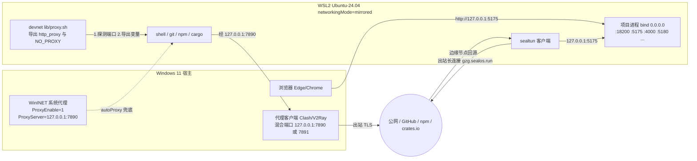
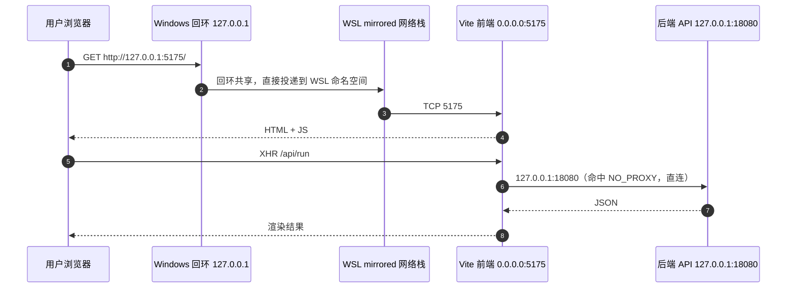
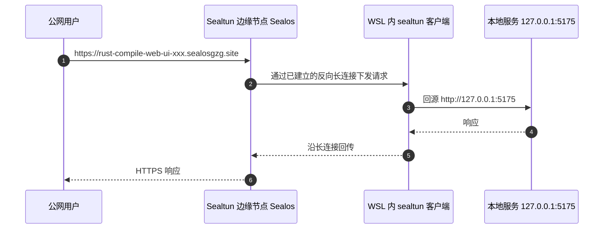
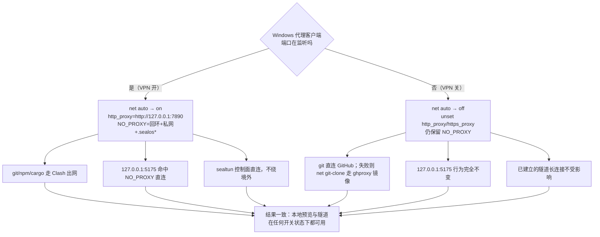
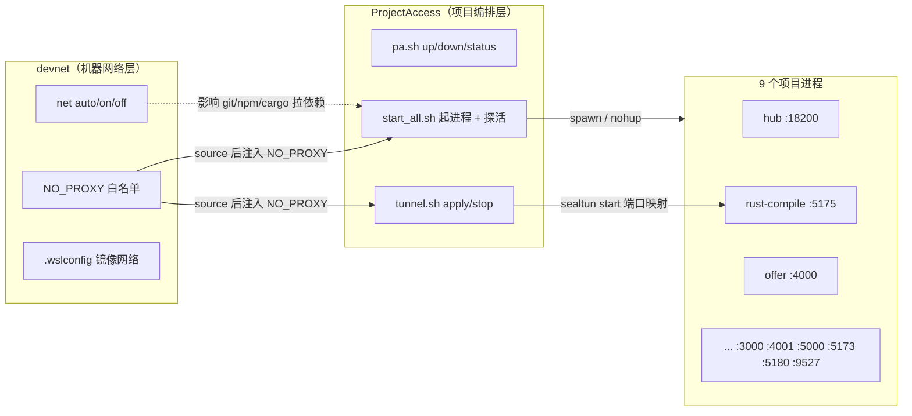

# devnet — WSL 开发网络层

> 机器级网络层：让 **VPN/代理可开可关**，而本地端口预览、`git/npm/cargo`、Sealtun 隧道三者都不受影响。
> 本仓库只改「网络环境变量与 WSL 网络模式」，**不启动/不停止任何项目进程**。
>
> 快照日期：2026-10-31 ｜ 适用：Windows 11 + WSL2 Ubuntu-24.04 ｜ 入口：`bin/net`

---

## 1. 它解决什么问题

一台 Windows 开发机上同时跑着 9 个 Web 项目，访问方式有三种：

| 访问者 | 路径 | 对代理的期望 |
|--------|------|--------------|
| Windows 浏览器 | `http://127.0.0.1:5175/` → WSL 内进程 | **绝不能**走代理 |
| WSL 里的 shell | `git` / `npm` / `cargo` 出站 | 有代理时走代理，没代理时直连或走镜像 |
| 公网用户 | `https://*.sealosgzg.site` → sealtun → 本地端口 | 控制面必须直连，不能被代理绕到境外 |

问题在于：`http_proxy` 是一个**全局**环境变量。设了就全走，不设就全不走。
于是出现三种典型故障：

1. 开了 VPN，`curl http://127.0.0.1:4000` 被送到代理，返回 **502**；
2. 关了 VPN，`http_proxy` 还残留着，`git clone` 卡死直到超时；
3. sealtun 的 `gzg.sealos.run` 被代理到境外节点，隧道建不起来或回源 502。

devnet 的做法是**把「走不走代理」变成一个可探测、可开关、带白名单的决策**：

- `http_proxy/https_proxy` 只在探测到 Windows 代理端口时才导出；
- `NO_PROXY` 永远包含 `127.0.0.1`、私网网段与 `*.sealos*` 域名；
- 每次开终端自动跑一次 `auto`，所以 VPN 开关后**新开一个 shell 就恢复正确状态**。

### 非目标（明确边界）

- 不管项目进程：启停、端口、日志由 `ProjectAccess` 的 `pa.sh` / `start_all.sh` 负责。
- 不改系统 DNS、不装 VPN、不改 Clash 配置；只读取端口是否可连。
- 不做全局持久化改写：`net on/off` 只影响**当前 shell**（`net install` 写入的 `~/.bashrc` 除外）。

---

## 2. 平台与前提

### 2.1 Windows 侧

- Windows 11 22H2+（mirrored 网络模式要求 WSL 2.0.0+）。
- 代理客户端（Clash Verge / Clash for Windows / V2RayN 等）监听本机回环：
  - Clash 常见 **7890**（混合端口）或 **7891**；V2RayN 常见 10808/10809。
  - 只需要监听 `127.0.0.1`，mirrored 模式下 WSL 能直接访问 Windows 回环；
  - 若 WSL 仍是 **NAT 模式**，必须打开客户端的 **Allow LAN / 允许局域网连接**，并放行 Windows 防火墙。
- Windows 系统代理（WinINET）状态可在注册表看到：

  ```text
  HKCU\Software\Microsoft\Windows\CurrentVersion\Internet Settings
    ProxyEnable = 1
    ProxyServer = 127.0.0.1:7890
    ProxyOverride = ...;localhost;127.*;10.*;172.16.*;...;*.local
  ```

  这些设置影响 Windows 应用与 WSL 的 `autoProxy`；`ProxyEnable=0` 表示系统代理关闭（但代理客户端**可能仍在监听端口**，这正是 devnet 探测的依据）。

### 2.2 WSL 侧

- 发行版：Ubuntu-24.04，普通用户 `ubuntu2404`。
- 推荐 `%UserProfile%\.wslconfig`（本仓库 `templates/wslconfig.mirrored` 生成）：

  ```ini
  [wsl2]
  networkingMode=mirrored
  dnsTunneling=true
  autoProxy=true

  [experimental]
  hostAddressLoopback=true
  ```

  - `networkingMode=mirrored`：WSL 与 Windows **共享回环**，`127.0.0.1` 双向可达；WSL 内也能直接连 Windows 的 `127.0.0.1:7890`。
  - `dnsTunneling=true`：DNS 走 Windows 解析器，避免自己写死 `8.8.8.8` 在关 VPN 时解析超时。
  - `autoProxy=true`：WSL 自动继承 Windows 系统代理（仅作兜底，devnet 仍显式管理环境变量）。
- Node/gh 在 `/opt/node/bin`（脚本里 `export PATH=/opt/node/bin:/usr/local/bin:/usr/bin:/bin`）。
- `/etc/wsl.conf` 里 `generateResolvConf=false` 时，`/etc/resolv.conf` 由人工维护，**关 VPN 后 DNS 是最容易出问题的地方**，见 §10。

### 2.3 当前机器的实测状态（2026-10-31）

| 项目 | 观测值 |
|------|--------|
| 网络模式 | mirrored（默认路由 `192.168.3.1`，`127.0.0.1` 可直达 Windows 服务） |
| `/etc/resolv.conf` | `nameserver 8.8.8.8 / 1.1.1.1 / 223.5.5.5`（手工写入） |
| Windows 系统代理 | 探测时 `ProxyEnable=0`（VPN 关闭态） |
| 代理端口 | 开 VPN 时实测 **7891**（`config.env` 默认列表里没有，需要手动加） |
| 本地在跑 | 5173 / 5175 / 5176 / 5180 / 5181 / 4000 / 4001 / 5000 / 18200 / 18080 / 3000 等 |

---

## 3. 一分钟安装

```bash
cd ~/code_jm/devnet
chmod +x bin/net

./bin/net install            # 写入 ~/.bashrc：每次开终端自动 auto 探测
./bin/net wslconfig --apply  # 生成并安装 Windows %UserProfile%\.wslconfig（镜像网络）
```

然后在 **Windows PowerShell**：

```powershell
wsl --shutdown          # 只有改 .wslconfig 才需要；会结束 WSL 内所有进程
```

> 注意：`wsl --shutdown` 会停掉 WSL 里正在跑的服务。若当前有 9 个项目在跑，
> **只做 `net install`，不要执行 wslconfig --apply + shutdown**，留到维护窗口。

重开 Ubuntu 后：

```bash
source ~/.bashrc
net status
net doctor
```

---

## 4. 整体拓扑（图 1）



**谁把包转给谁：**

1. **出站（WSL → 外网）**：`git/npm/cargo` 读 `http_proxy`，把请求发给 `127.0.0.1:7890`；
   mirrored 模式下这个 `127.0.0.1` 就是 **Windows 的回环**，于是包落到 Clash；Clash 再出公网。
   VPN 关掉时 Clash 端口消失，`devnet_detect_proxy_endpoint` 探测失败 → 不导出代理 → 直连（失败则走镜像）。
2. **本地预览（Windows 浏览器 → WSL 进程）**：浏览器访问 `127.0.0.1:5175`，mirrored 网络把回环共享给 WSL，
   直接命中 `0.0.0.0:5175` 的 Vite。这条路径**不经过 Clash**（也没人可以经过，因为目标是回环地址）。
3. **公网（用户 → 隧道 → 本地）**：sealtun 客户端从 WSL **主动出站**连到 Sealos 边缘，隧道复用这条长连接；
   公网请求到达边缘后沿长连接下发到 WSL 客户端，客户端再回源 `127.0.0.1:5175`。回源是本机回环，同样不过代理。

---

## 5. 一个请求的完整路径（图 2）

### 5.1 本地预览：浏览器 → Windows 回环 → WSL 服务



要点：

- Windows 浏览器里的 `127.0.0.1` 与 WSL 里的 `127.0.0.1` 在 mirrored 模式下是**同一个回环**；
  进程必须 `bind 0.0.0.0`（或 `::`）才能被「另一侧」访问，只绑 `127.0.0.1` 时仅本命名空间可见。
- 这条链路上**没有任何代理参与**：目标地址就是回环，`NO_PROXY` 里也永远有 `127.0.0.1`。

### 5.2 公网访问：用户 → Sealtun 边缘 → WSL 客户端 → 本地端口



要点：

- 隧道方向是 **WSL 主动出站**，所以不需要公网 IP、不需要端口映射、不需要 Windows 防火墙放行入站。
- 出站目标是 `gzg.sealos.run` / `*.sealosgzg.site`，这些域名在 `NO_PROXY` 里，**必须直连**：
  一旦被 Clash 转到境外节点，TLS 会被中间节点重置 → 表现为隧道 502 或 `sealtun list` 长时间无响应。
- 隧道只做「端口 → 公网域名」的映射，不关心进程是否健康；进程挂了它照样返回 502。

---

## 6. VPN 开 / 关两种情形（图 3）



### 6.1 系统代理开启时会发生什么

| 层面 | 开启（`ProxyEnable=1`，`ProxyServer=127.0.0.1:7890`） | 关闭（`ProxyEnable=0`） |
|------|--------------------------------------------------|------------------------|
| Windows 浏览器 | 访问外网走 Clash；访问 `127.0.0.1` 命中 `ProxyOverride` 里的 `127.*`，直连 | 全部直连 |
| WSL 环境变量 | devnet 探测到 7890 → 导出 `http_proxy` | 探测失败 → 清空 `http_proxy` |
| `git clone github.com` | 走 Clash，通常成功 | 直连多半失败 → `net git-clone` 用镜像 |
| `npm install` | 走 Clash 或国内镜像 | 直连 registry 常超时；建议 `registry.npmmirror.com`（已在 NO_PROXY） |
| `cargo build` | 走 Clash 拉 crates.io | 直连慢；可配 `~/.cargo/config.toml` 镜像 |
| sealtun | 必须让 `.sealosgzg.site` / `.sealos.run` 绕过 | 无影响 |

### 6.2 为什么 `127.0.0.1` 天然绕过代理

代理协议（HTTP CONNECT / SOCKS）的语义是「帮我把包送到**别的**主机」。
当目标本身就是 `127.0.0.1` 时：

1. 客户端库（curl、requests、Go 的 `ProxyFromEnvironment`）会先查 `NO_PROXY`，命中就不建代理连接；
2. 即使没配 `NO_PROXY`，把「访问本机」发给代理也是错的——代理在**另一台机器（Windows）**上，
   它眼中的 `127.0.0.1` 是 Windows 自己，而不是 WSL 里的服务 → 轻则 502，重则连到错误的进程。

所以 devnet 的策略是「双保险」：`NO_PROXY` 永远带 `localhost,127.0.0.1,::1`，
同时在文档和脚本里约定**本地预览只用回环地址**。

### 6.3 为什么 `NO_PROXY` 要加 `.sealosgzg.site`

`NO_PROXY` 的域名匹配是**后缀匹配**：写 `.sealosgzg.site` 会同时命中
`abc.sealosgzg.site`、`x.y.sealosgzg.site`。需要加它的原因：

- sealtun 的隧道域名是随机子域（`*-xxx.sealosgzg.site`），无法逐个列举；
- 隧道 SDK 内部会用 HTTP 客户端访问自己的控制面/健康检查地址，
  若继承 `http_proxy`，请求会被送到 Clash，再被境外节点按域名分流，
  常见结果是 **TLS 握手被重置**、`502 Bad Gateway`、或隧道反复重连；
- `.sealos.run` 是 Sealos 主控（`gzg.sealos.run` 的父域），`.aliyuncs.com` 是国内对象存储/镜像，
  都属于「国内直连更快更稳」的流量。

同一个 `devnet_no_proxy_list` 还顺带加了 `registry.npmmirror.com`、`mirrors.aliyun.com`、
`npm.taobao.org`，避免国内镜像被绕到境外再回来。

---

## 7. 命令说明

入口：`bin/net`（`net install` 后会注册别名 `net`）。
所有命令都只改**当前 shell 的环境变量**，除 `install`（写 `~/.bashrc`）和 `wslconfig`（写 Windows 文件）。

| 命令 | 作用 | 是否影响正在运行的服务 |
|------|------|------------------------|
| `net status` | 先按 `DEVNET_MODE` 应用一次，再打印 `windows_host / mode / proxy_state / http_proxy / NO_PROXY / git_mirror` | 否 |
| `net auto` | 探测代理：有则导出代理，无则清空；状态写成 `auto:on:host:port` 或 `auto:off` | 否 |
| `net on` | 强制走代理；探测不到端口时报错并保持 off（`off(missing)`） | 否 |
| `net off` | 清空 `http_proxy/https_proxy/ALL_PROXY`，保留 `NO_PROXY` | 否 |
| `net doctor` | 体检：代理端点、localhost 直连、GitHub HTTPS、Sealos 控制面、样例端口 18200/5175/18080/4000/3000/5000 | 否 |
| `net git-clone <url> [dir]` | 先 `devnet_git_prepare`：有代理走 GitHub；无代理用 `insteadOf` 临时改写到 `https://ghproxy.net/` | 否 |
| `net install` | 把 `source lib/proxy.sh` + `devnet_bootstrap` + `alias net=...` 写入 `~/.bashrc`（带 marker，可重复执行） | 否 |
| `net wslconfig [--apply]` | 生成 `templates/wslconfig.mirrored` 并可选复制到 `%UserProfile%\.wslconfig`（先备份为 `.bak.<时间戳>`） | 写文件；**应用需手动 `wsl --shutdown`** |

### 7.1 库函数（`lib/proxy.sh`，可被其它脚本 source）

| 函数 | 作用 |
|------|------|
| `devnet_windows_host` | 取 Windows 宿主地址：默认路由网关（私网才认）→ `/etc/resolv.conf` 里的私网 nameserver → 兜底 `127.0.0.1` |
| `devnet_tcp_open host port` | `timeout 0.4` 的 TCP 探测，**永不挂起** |
| `devnet_detect_proxy_endpoint` | 按 `DEVNET_PROXY_PORTS` 顺序探测「Windows 宿主 + 127.0.0.1」，返回第一个可连的 `host:port` |
| `devnet_no_proxy_list` | 生成 `NO_PROXY`：回环 + 私网段 + `.sealos*` + 国内镜像 + Windows 宿主 IP |
| `devnet_clear_proxy_env` | 清代理变量，仅保留 `NO_PROXY` |
| `devnet_apply_proxy_env <endpoint>` | 同时导出大小写两套变量（`http_proxy/HTTP_PROXY/...`）与 `NO_PROXY` |
| `devnet_proxy_apply [auto\|on\|off]` | 唯一入口：设置 `DEVNET_PROXY_STATE`，返回值表示是否真的用上代理 |
| `devnet_git_prepare` | `git clone` 前调用：有代理→清镜像；无代理→设置进程级 `GIT_CONFIG_*`（不改 `~/.gitconfig`） |
| `devnet_git_use_mirror` / `devnet_git_clear_mirror` | 进程内 `url.<mirror>https://github.com/.insteadOf` 的开关 |
| `devnet_bootstrap` | 登录 shell 用：先设 `NO_PROXY`，再 `auto`，失败也不报错 |
| `devnet_status` | 打印状态块（`net status` 的实现） |

### 7.2 状态值含义

| `DEVNET_PROXY_STATE` | 含义 |
|----------------------|------|
| `auto:on:127.0.0.1:7891` | 自动探测成功，正在走代理 |
| `auto:off` | 自动探测失败，已清空代理变量 |
| `on:127.0.0.1:7890` | `net on` 强制成功 |
| `off(missing)` | `net on` 但端口不通，已回退为直连 |
| `off` | `net off` 显式关闭 |

---

## 8. 配置文件 `config.env`

```bash
DEVNET_PROXY_PORTS="7890 7897 10809 10808 20171 8080"  # 依次探测的代理端口
DEVNET_PROXY_SCHEME="http"        # http | socks5
DEVNET_MODE="auto"                # auto | on | off
DEVNET_GIT_MIRROR="https://ghproxy.net/"   # 无代理时 git 的 GitHub 前缀镜像
DEVNET_WSL_MIRRORED="1"           # net wslconfig 是否直接写入 .wslconfig
```

| 字段 | 类型 | 说明 | 改动影响 |
|------|------|------|----------|
| `DEVNET_PROXY_PORTS` | 空格分隔端口 | 探测顺序，**必须包含你客户端的实际端口** | 少了就会「VPN 开着但 net 认为没代理」 |
| `DEVNET_PROXY_SCHEME` | `http`/`socks5` | 拼成 `scheme://host:port` | socks5 需客户端支持 SOCKS，且部分工具不认 `ALL_PROXY` |
| `DEVNET_MODE` | `auto`/`on`/`off` | 默认行为；`net auto/on/off` 会临时覆盖 | 设 `on` 会在无代理时反复告警 |
| `DEVNET_GIT_MIRROR` | URL 前缀 | 仅 `net git-clone` 且无代理时生效；**只管读，不管 push** | 镜像不支持 push，推代码仍需代理 |
| `DEVNET_WSL_MIRRORED` | `0`/`1` | 控制 `net wslconfig` 是否直接写文件 | 写文件后仍需手动 `wsl --shutdown` 才生效 |

> `config.env` 由 `lib/proxy.sh` 在 source 时读取，所以改完要**新开 shell 或重新 source**。

---

## 9. 与 ProjectAccess 的边界

一句话：**devnet 管「包怎么出去」，ProjectAccess 管「进程怎么起来」。**



### 9.1 职责对照

| 维度 | devnet | ProjectAccess |
|------|--------|---------------|
| 关注点 | 环境变量、代理探测、WSL 网络模式、DNS 兜底 | 端口分配、进程启停、健康检查、隧道生命周期 |
| 入口 | `bin/net` | `pa.sh` / `start_all.sh` / `stop_all.sh` / `tunnel.sh` |
| 是否启停进程 | **否** | 是 |
| 是否碰 `~/.bashrc` | 仅 `net install` | 否 |
| 是否碰 Windows 文件 | 仅 `net wslconfig` | 否（除隧道配置外） |
| 依赖关系 | 无 | 软依赖：`start_all.sh`/`tunnel.sh` 会 source `devnet/lib/proxy.sh` 拿 `NO_PROXY` |

### 9.2 端口与隧道映射（来自 `sealtun.yaml`）

| 项目 | 本地端口 | 隧道名 | 备注 |
|------|----------|--------|------|
| hub | 18200 | `project-access` | 项目导航页 |
| wisdom | 9527 | `wisdom-ui` | |
| westchina | 5000 | `westchina-ui` | 需 JDK8 + MySQL |
| encoding | 3000 | `encoding-practice-web` | |
| offer | 4000 | `offer-ui` | 被 `projects-config.json` 的 `hide_project_ids` 隐藏 |
| cplusbook | 4001 | `cplusbook-ui` | |
| rust-compile | 5175 | `rust-compile-web-ui` | |
| fengsheng | 5173 | `fengsheng-vue` | |
| rust-thread | 5180 | `rust-thread-async-memory-ui` | |

### 9.3 常用组合

```bash
# 只起本地，不碰隧道（最安全，适合排查前端）
cd ~/code_jm/deployProject/ProjectAccess
bash pa.sh up-local rust-compile

# 本地 + 隧道
bash pa.sh up rust-compile

# 看端口与隧道
bash pa.sh status
bash pa.sh url

# 网络层单独体检
net doctor
```

---

## 10. 故障排查

### 10.1 快速对照表

| 现象 | 最可能原因 | 处理 |
|------|-----------|------|
| `net status` 显示 `auto:off`，但 Clash 明明开着 | 端口不在 `DEVNET_PROXY_PORTS`；或 Clash 只监听 `127.0.0.1` 而 WSL 是 NAT 模式 | 把实际端口加进 `config.env`；或开 Allow LAN；或切 mirrored |
| `git clone` 卡住 / `GnuTLS recv error -110` | 没代理且直连被墙；`http_proxy` 指向已关闭的端口 | `net off` 后重试；或 `net git-clone <url>` 走镜像 |
| `npm install` 超时 | 同上；或 registry 太慢 | `net auto`；或 `npm config set registry https://registry.npmmirror.com` |
| WSL 里 `curl http://127.0.0.1:4000` 返回 **502** | 请求被送到了代理（代理连不上 WSL 的回环） | `net off` 或确认 `NO_PROXY` 含 `127.0.0.1`；`echo $http_proxy` 自查 |
| 公网隧道 **502** | 隧道在、本地端口没进程；或 sealtun 控制面被代理 | `bash pa.sh status` 看端口；`net off` 后重建隧道 |
| `sealtun list` 很久没响应 | 控制面 `gzg.sealos.run` 走了境外代理 | 确认 `NO_PROXY` 含 `.sealos.run,.sealosgzg.site` |
| Windows 打不开 `127.0.0.1:5175` | 进程绑了 `127.0.0.1` 而非 `0.0.0.0`；或 NAT 模式没开 `localhostForwarding` | 改 `--host 0.0.0.0`；或用 `hostname -I` 的 IP；或切 mirrored |
| 关 VPN 后 DNS 全挂 | `/etc/resolv.conf` 写死了 `8.8.8.8` 且被墙 | `dnsTunneling=true`；或换成 `223.5.5.5`；或 `generateResolvConf=true` |
| 开机后所有 shell 都慢 2 秒 | `devnet_bootstrap` 在探测一个不存在的代理端口 | 正常（每个端口 0.4s 超时）；精简 `DEVNET_PROXY_PORTS` |

### 10.2 代理端口不通

```bash
# 1) Windows 侧真的在监听吗（PowerShell）
netstat -ano | findstr :7890

# 2) WSL 侧能不能连（mirrored 模式下应能直连 127.0.0.1）
timeout 1 bash -c '</dev/tcp/127.0.0.1/7890' && echo OPEN || echo CLOSED

# 3) 代理是否真是 HTTP 代理（能 CONNECT 才算）
curl -sS -x http://127.0.0.1:7890 -o /dev/null -w '%{http_code}\n' https://api.github.com/

# 4) 换端口
DEVNET_PROXY_PORTS="7891 7897 10809" net auto
```

### 10.3 VPN 开关后 git / npm 失效

- **开 VPN 后仍直连**：旧 shell 里没有 `http_proxy`。`source ~/.bashrc` 或 `net auto`。
- **关 VPN 后仍走代理**：`http_proxy` 残留。`net off`；`env | grep -i proxy` 确认清空。
- **`git` 用了镜像导致 push 失败**：`devnet_git_use_mirror` 只对 `net git-clone` 的进程生效；
  手动 push 前确认 `env | grep GIT_CONFIG` 为空，必要时 `unset GIT_CONFIG_COUNT GIT_CONFIG_KEY_0 GIT_CONFIG_VALUE_0`。

### 10.4 WSL 里 curl 502

502 是**代理**返回的（不是目标服务），说明请求确实进了代理：

```bash
env | grep -i proxy          # 看 http_proxy/https_proxy
curl -v --noproxy '*' http://127.0.0.1:4000/   # 强制绕过，验证服务本身
```

若 `--noproxy` 正常、默认 502，就是 `NO_PROXY` 没生效：
`NO_PROXY` 必须用逗号分隔、包含 `127.0.0.1`（`localhost` 不够，浏览器/工具可能解析成 `::1`，所以 `::1` 也要写）。

### 10.5 隧道 502

按「边缘 → 长连接 → 回源」三段排查：

1. `sealtun list` 是否有该隧道且状态正常（控制面直连）；
2. `bash tunnel.sh status` / `pa.sh status` 本地端口是否 UP；
3. `curl -v http://127.0.0.1:5175/` 本地直连是否 200。

边缘 502 通常是第 2/3 步失败；若本地正常但公网 502，考虑隧道进程被代理污染 → `net off` 后 `tunnel.sh stop && tunnel.sh apply`。

### 10.6 DNS

- mirrored + `dnsTunneling=true` 时，DNS 由 Windows 代解析，最稳；
- `generateResolvConf=false` + 手写 `8.8.8.8` 的组合，在关 VPN 时会 2s×3 超时后才回退，
  表现为 `npm install`「卡很久然后成功」；
- 国内环境建议 `223.5.5.5` 优先，或恢复 `generateResolvConf=true`。

---

## 11. 文件清单

```text
devnet/
├── README.md                     # 本文（总览 + 图 1/2 + VPN 对比 + 命令 + 排障）
├── config.env                    # 端口/模式/镜像/镜像网络开关
├── bin/net                       # CLI：status auto on off doctor git-clone install wslconfig
├── lib/proxy.sh                  # 核心库：探测、导出、NO_PROXY、git 镜像
├── templates/wslconfig.mirrored  # 镜像网络模板（install 时复制为 .wslconfig）
├── templates/wslconfig.generated # net wslconfig 生成的副本
├── docs/network.md               # 深挖：数据包路径、mirrored vs NAT、NO_PROXY 规则、时序图
├── smoke_online_rust_compile.sh  # 冒烟：网络层 + rust-compile 本地预览（可选隧道）
└── _retest.sh                    # 现场复测脚本（ip route / doctor / git-clone）
```

## 12. 设计取舍

1. **探测端口而不是读注册表**：读 `ProxyEnable` 只能知道「系统代理开没开」，
   而 Clash 的 TUN 模式可能不设系统代理却能出网；探测 TCP 端口更接近真实可用性。
2. **只导出环境变量，不改 `/etc/environment`**：避免把某次 VPN 状态固化到系统级，
   导致下次开机没网却找不到原因。
3. **`NO_PROXY` 常驻、代理变量可空**：把「必须直连」的名单做成不变量，
   这样无论 VPN 开关，本地预览与隧道的行为都一致。
4. **git 镜像用进程级 `GIT_CONFIG_*`**：不污染 `~/.gitconfig`，退出即失效；
   代价是镜像只支持读，push 仍需代理。
5. **文档只描述、不自动改 `.wslconfig`**：切网络模式需要 `wsl --shutdown`，
   会杀掉所有正在运行的服务，必须由人决定时机。
