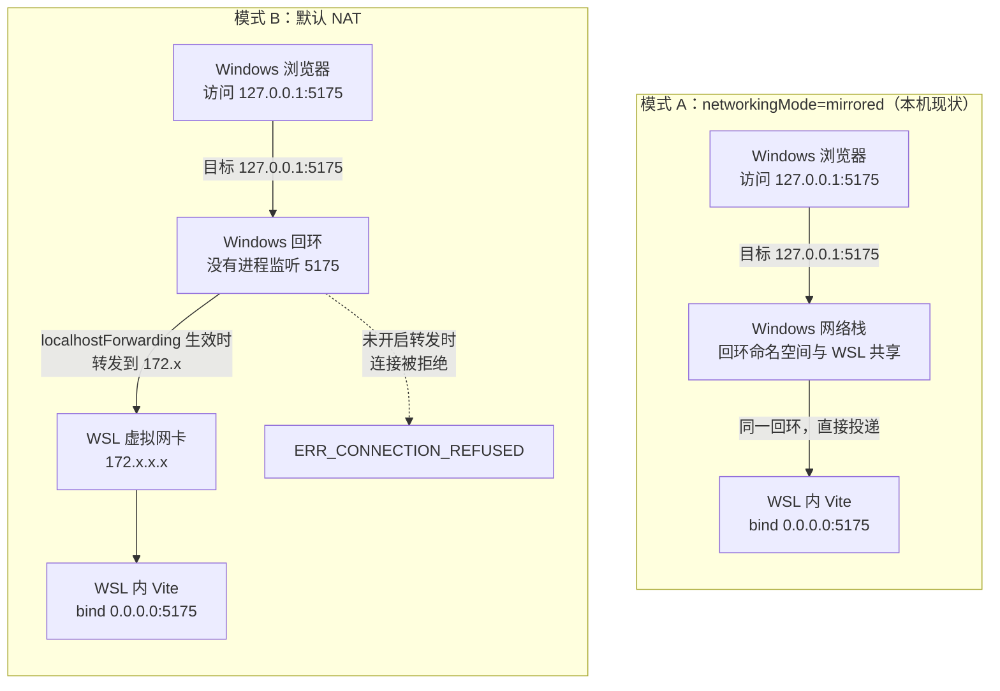
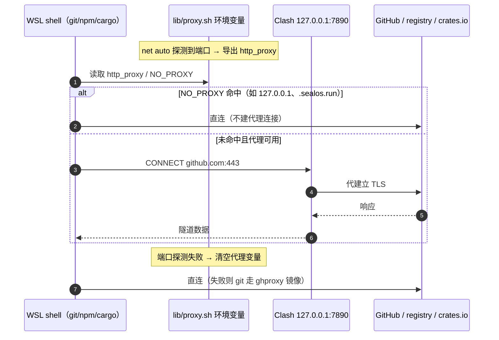
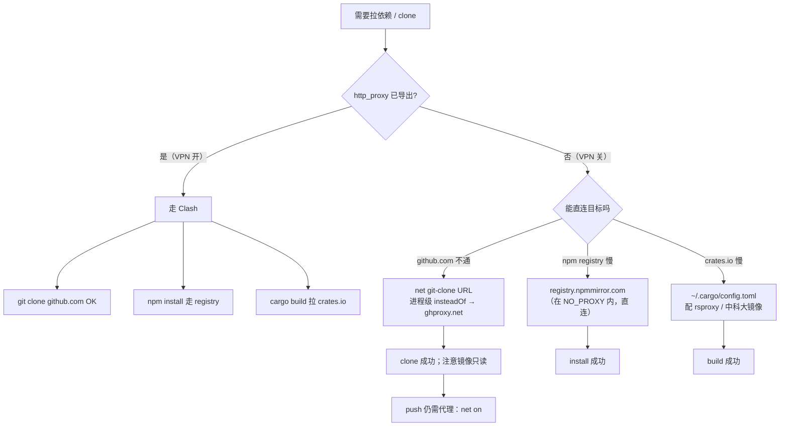
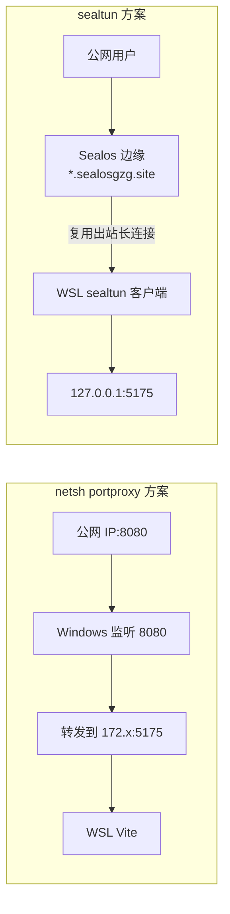

# 网络深挖：数据包到底怎么走

本文是 [`README.md`](../README.md) 的补充，回答四个具体问题：

1. mirrored 与 NAT 两种模式下，Windows 浏览器访问 `127.0.0.1:5175` 的包分别走哪里？
2. `NO_PROXY` 到底按什么规则匹配？为什么有的工具「配了也不生效」？
3. `git` / `npm` / `cargo` 在有代理、无代理时各自走哪条路？
4. 为什么隧道不用 `netsh portproxy` 做端口映射？

---

## 1. mirrored vs NAT：同一个 `127.0.0.1`，两种命运



**谁把包转给谁：**

- **mirrored**：Windows 与 WSL 共享同一个回环地址空间。浏览器发给 `127.0.0.1:5175` 的包
  由 **Windows 网络栈直接投递给 WSL 里的监听者**，没有 NAT、没有额外转发进程。
  这就是「WSL 里 `127.0.0.1:7890` 能连到 Windows 上的 Clash」的同一条机制的反向应用。
- **NAT**：WSL 在独立子网（`172.x`），Windows 的 `127.0.0.1` 与 WSL 的 `127.0.0.1` 是**两个不同的回环**。
  浏览器访问 `127.0.0.1:5175` 时，只有 `localhostForwarding=true`（默认开）才会由 Windows 侧的
  转发代理把连接送到 WSL 的 `172.x`；不满足条件就是连接被拒绝。
- 两种模式都要求进程 **bind `0.0.0.0`**：绑 `127.0.0.1` 时只有「自己那一侧」能连。

### 1.1 模式差异对照

| 能力 | mirrored | NAT |
|------|----------|-----|
| Windows → WSL `127.0.0.1:port` | 直接可用 | 依赖 `localhostForwarding`，偶发失效 |
| WSL → Windows `127.0.0.1:7890` | 直接可用（代理只需监听回环） | **不可用**，必须 Allow LAN + 用 `172.x` 网关 IP |
| WSL 访问 Windows 上的服务 | 用 `127.0.0.1` | 用 `$(ip route \| awk '/default/{print $3}')` |
| 局域网设备访问 WSL | 直接可用 | 需要 `netsh portproxy` |
| IPv6 | 与 Windows 一致 | 需额外配置 |
| 切换代价 | `wsl --shutdown`（**会杀掉所有进程**） | 同左 |

> 本机实测（2026-10-31）：默认路由 `192.168.3.1`，`127.0.0.1` 可直达 Windows 侧服务 → 处于 mirrored。
> `net status` 打印的 `windows_host` 在 mirrored 下会退化成 `127.0.0.1`，这是**正确**的，不是探测失败。

---

## 2. 一次出站请求的两种走法（有代理 / 无代理）



**谁把包转给谁：**

1. `git`/`npm`/`cargo` 都是读环境变量决定是否建代理连接（curl/libcurl、Go `ProxyFromEnvironment`、
   Node 的 `proxy-from-env` 行为一致：先查 `NO_PROXY`，再查 `http_proxy`）。
2. 建了代理连接后，**包先到 Clash**，由 Clash 按规则决定直连还是走节点；此时 TLS 是「客户端 ↔ Clash」+
   「Clash ↔ 目标」两段，所以抓包看到的目的 IP 是 `127.0.0.1`。
3. 没有代理变量时，包直接发往目标 IP；被墙时表现为 `GnuTLS recv error (-110)`、`Connection reset`、
   或长时间无响应（`--max-time` 才会退出）。

---

## 3. `NO_PROXY` 的匹配规则（以及为什么常常「配了没用」）

主流实现的匹配逻辑（curl / libcurl / git 共用一套）：

```text
输入：no_proxy 列表（逗号分隔）、目标主机名 host
1. 逐项 trim 空白，忽略大小写
2. 若某项是 "*" → 全部直连
3. 去掉项开头的 "."（部分实现保留，但语义是「后缀」）
4. 若 host == 项               → 命中
5. 若 host 以 "." + 项 结尾    → 命中（子域）
6. 若项是 IP/CIDR（部分实现支持）→ 按网段匹配
```

由此得到三条实战结论：

| 写法 | 能匹配 | 不能匹配 |
|------|--------|----------|
| `sealosgzg.site` | 该域名本身 + `x.sealosgzg.site`（多数实现按后缀比较） | —— |
| `.sealosgzg.site` | `x.sealosgzg.site`、`a.b.sealosgzg.site` | **`sealosgzg.site` 本身**（curl 的 `tail match` 需要前导点） |
| `127.0.0.1` | 仅 IPv4 回环 | `localhost` 解析出的 `::1`（必须另写 `::1`） |

所以 devnet 的 `devnet_no_proxy_list` 同时给出 `localhost`、`127.0.0.1`、`::1`，
以及 `.sealos.run`、`.sealosgzg.site` 这类带点的后缀项——**隧道子域是随机的，只能靠后缀覆盖**。

> 兼容性注意：Go 的 `httpproxy` 会把前导点去掉后按后缀匹配（所以 `.sealos.run` 也能匹配 `sealos.run` 本身），
> 而 curl 不会。若遇到「Go 写的工具能过、curl 不能过」，就是这条差异。
> 需要覆盖裸域名时，把 `sealosgzg.site` 与 `.sealosgzg.site` **两个都写**。

### 3.1 自测方法

```bash
# 看当前值（注意大小写两套变量都可能存在）
env | grep -i no_proxy

# 验证某个域名是否绕过
curl -v --max-time 5 https://gzg.sealos.run 2>&1 | grep -E 'Uses proxy|Trying'

# 验证回环
curl -v --max-time 3 http://127.0.0.1:4000/ 2>&1 | grep -E 'Uses proxy|Connected to'
```

`curl -v` 输出里出现 `Uses proxy env variable http_proxy == '...'` 就说明被代理接管了。

---

## 4. `git` / `npm` / `cargo` 的决策树



**要点：**

- `ghproxy.net` 只做「读」的加速（`git clone` / `git fetch`），**push 一定失败**；
  推代码前必须 `net on` 恢复代理，或直接 `net off` 后走 SSH（需另配 key）。
- `devnet_git_use_mirror` 用 `GIT_CONFIG_COUNT/KEY_0/VALUE_0` 注入 `insteadOf`，
  作用域仅**当前进程**，退出即消失，不会污染 `~/.gitconfig`。
- `npm` 的 `registry` 与 `http_proxy` 是两条独立路径：即使代理开着，配了国内 registry 也会直连
  （因为 registry 在 `NO_PROXY` 里）。
- `cargo` 不读 `NO_PROXY` 的域名部分（它用 HTTP 客户端自己的逻辑），国内建议直接配镜像源。

---

## 5. 端口探测：为什么 0.4 秒、为什么先 Windows 后回环

`devnet_detect_proxy_endpoint` 的顺序是：

```text
for port in $DEVNET_PROXY_PORTS:
    for host in $(devnet_windows_host) 127.0.0.1:
        if tcp_open(host, port, timeout=0.4): return host:port
```

- **先 Windows 宿主**：NAT 模式下 Windows 的代理只监听自己的回环，必须用网关 IP 访问；
  Windows 宿主优先可以让同一份配置同时适配 mirrored（网关就是 127.0.0.1 的等价物）与 NAT。
- **再回环**：mirrored 模式下 `127.0.0.1` 就是 Windows 回环，能连上；NAT 模式下这一步必然失败，只损失 0.4s。
- **0.4s 上限**：`timeout` 命令保证不挂起；端口列表有 6 个，最坏情况单次 `net auto` 约 2.4s，
  可以接受（登录 shell 只跑一次）。
- 探测的是 **TCP 可连**，不是 HTTP 可用：Clash 的混合端口同时支持 HTTP/SOCKS，
  只要能建 TCP 连接就认为「代理活着」，具体协议由 `DEVNET_PROXY_SCHEME` 决定。

### 5.1 误判的两种情形

| 情形 | 现象 | 处理 |
|------|------|------|
| 端口被**非代理**程序占用（如 8080 被某个 Web 服务占用） | `net auto` 认为有代理，实际 CONNECT 失败 → 所有出站 502 | 从 `DEVNET_PROXY_PORTS` 移除该端口 |
| 代理是 TUN/透明代理，不监听端口 | 探测失败 → 直连，但 TUN 已经接管流量 | 直连也能出网，无影响；不要强行 `net on` |

---

## 6. 为什么隧道不用 `netsh portproxy`

`netsh interface portproxy add v4tov4` 是「Windows 监听端口 → 转发到 WSL IP」的方案，它的问题：

1. **需要管理员权限**，且规则在重启后可能失效；
2. **只解决入站**，公网访问还需要公网 IP + 路由器端口映射 + 防火墙放行；
3. WSL 的 IP 在 NAT 模式下**每次重启会变**，规则要跟着改；
4. 明文 HTTP 暴露到公网，没有 TLS、没有鉴权。

sealtun 的做法相反：**WSL 主动出站**建一条到边缘节点的长连接，边缘把公网域名映射到这条连接上。
好处是不需要公网 IP、不需要改防火墙、天然带 TLS 与域名，代价是依赖边缘节点可用性。



---

## 7. 与 Windows 系统代理（autoProxy）的关系

`.wslconfig` 里的 `autoProxy=true` 会让 WSL 在启动时读取 Windows 的 WinINET 设置并注入环境变量。
这和 devnet 是**两套机制**：

| 机制 | 触发时机 | 缺点 |
|------|----------|------|
| `autoProxy=true` | WSL 启动 / 网络变化 | 只在启动时读一次；VPN 中途开关不更新；可能注入到不该走代理的进程 |
| `devnet_bootstrap`（`net install` 后） | 每次开交互式 shell | 只影响 shell 及其子进程；`systemd` 服务不受影响 |

两者叠加不冲突：`devnet_proxy_apply` 会**覆盖**（而不是追加）`http_proxy`，并在探测失败时清空，
所以哪怕 `autoProxy` 注入了一个已失效的端口，`net auto` 也会把它纠正回 `off`。

> 这也是为什么「VPN 关了但 git 还是卡」的经典问题，用 `net off` 或新开 shell 就能解决。

---

## 8. 现场复测清单

```bash
# 1. 网络模式与宿主地址
ip route | head -3
cat /etc/resolv.conf
source lib/proxy.sh && devnet_windows_host

# 2. 代理端点
source lib/proxy.sh && devnet_detect_proxy_endpoint

# 3. 环境变量与状态
net status

# 4. 三段连通性
curl -sS -o /dev/null -w 'github %{http_code}\n' --max-time 8 https://github.com/
curl -sS -o /dev/null -w 'sealos %{http_code}\n' --max-time 8 https://gzg.sealos.run
curl -sS -o /dev/null -w 'local  %{http_code}\n' --max-time 3 http://127.0.0.1:4000/

# 5. git 通道
net git-clone https://github.com/JMILI/devnet.git /tmp/devnet-probe
```

对应脚本：`_retest.sh`（原样复测）、`smoke_online_rust_compile.sh`（网络层 + 本地预览冒烟）。
